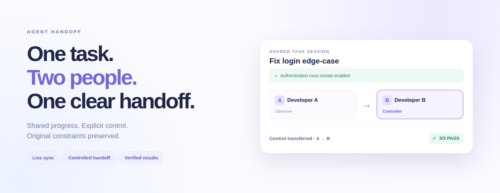

<div align="center">



# Agent Handoff

**One AI task. Multiple humans. No lost context.**

A local-first shared workspace where two people follow the same task, hand over control explicitly, and keep the original constraints in force.

[](https://nodejs.org/)
[](#quick-start)
[](#try-the-handoff)
[](https://github.com/hkalbertkim/agent-handoff/actions/workflows/verify.yml)
[](https://github.com/hkalbertkim/agent-handoff/actions/workflows/browser-qc.yml)

</div>

## See it in action


*Actual Chromium recordings: Developer A (left) passes control to Developer B (right). The two pages use one server-owned task state. No simulated UI.*

## Contents

- [Quick start](#quick-start) — run locally without accounts or dependencies
- [Try the handoff](#try-the-handoff) — follow the A → B workflow
- [How it works](#how-it-works) — server authority, events, and constraints
- [Verify it](#verify-it) — run automated tests and browser recordings
- [Current scope](#current-scope) — verified features and limitations
- [Troubleshooting](#troubleshooting) — common setup issues

## Quick start

**Requirements:** Node.js 20+ and Git. No Docker, database, API key, or `npm install` required for the basic demo.

```bash
git clone https://github.com/hkalbertkim/agent-handoff.git
cd agent-handoff
npm start
```

The terminal prints **two distinct invitation links**:

```text
A/controller: http://127.0.0.1:4177/?token=...
B/observer:   http://127.0.0.1:4177/?token=...
```

Open the A link in one browser window and the B link in another window **on the same computer**. Keep the server running.

> **Security:** Invitation URLs contain private bearer tokens. The server binds to `127.0.0.1` by default. Do not publish the links or expose the server to the internet.

## Try the handoff

| Step | Developer A | Developer B | Result |
| --- | --- | --- | --- |
| **1. Start** | Click **Start task** | Observe | Both see the same task and live activity |
| **2. Diagnose** | Click **Scripted diagnosis** | Observe | Both see the diagnosis in the event history |
| **3. Hand off** | Click **Offer handoff** | Click **Accept handoff** | The current controller becomes **B** on both screens |
| **4. Check authority** | Expand **Developer verification tools** and test the observer command | Observe | A is rejected by the server with **HTTP 403** |
| **5. Enforce constraints** | Observe | Expand developer tools and select **Attempt: disable auth** | The server blocks the prohibited change |
| **6. Complete** | Observe | Click **Apply safe fix & test** | **3/3 password-boundary assertions pass** |

The fixture corrects `password.length > 8` to `password.length >= 8` while preserving authentication.

## How it works

The server is the **single source of truth**. Browsers display its state; they do not decide who has permission.

| Component | Responsibility |
| --- | --- |
| **Shared task state** | One session ID, task status, required constraints |
| **Controller / Observer** | Only the active controller can execute task commands |
| **Explicit handoff** | Current controller offers; named recipient accepts |
| **Ordered events** | Both browsers receive live updates through Server-Sent Events |
| **Policy and tests** | Constraints are checked by the server, not trusted to an AI prompt |

The interface uses an off-white canvas with pale blue and lavender accents. Detailed fixture output and developer verification controls stay in expandable sections.

## Verify it

Run the dependency-free Node test suite:

```bash
npm test
```

To reproduce the **real two-browser test and recordings**:

```bash
npm install --no-save playwright
npx playwright install chromium
npm run demo:record
```

The browser run saves `developer-a-real-browser.webm`, `developer-b-real-browser.webm`, and the post-handoff screenshots in `artifacts/`.

[View recorded browser evidence and CI](https://github.com/hkalbertkim/agent-handoff/actions/workflows/browser-qc.yml)

## Current scope

| Implemented and tested | Not implemented |
| --- | --- |
| One live session with two human participants | Arbitrary autonomous coding tasks |
| Server-authorized handoff, including old-controller rejection | Transfer of a model's hidden context between LLMs |
| Task constraints preserved and checked after handoff | Durable distributed sessions or user accounts |
| Deterministic safe fixture fix and three actual assertions | Shared long-term gbrain memory |
| Optional **read-only** model diagnosis adapter (mock-tested) | Production multi-agent orchestration |

**The default worker is a deterministic fixture, not a general-purpose coding agent.** The optional LLM diagnosis never applies code changes and needs a separate API key. Live provider execution has not been verified in CI.

To try the optional read-only diagnosis, use an API model available to your account:

```bash
OPENAI_API_KEY=your_key OPENAI_MODEL=your_model npm start
```

Keep API keys local and out of the repository.

## Troubleshooting

| Issue | Fix |
| --- | --- |
| `node` is missing or older than v20 | Install [Node.js 20+](https://nodejs.org/) |
| Port 4177 is busy | Use `PORT=4180 npm start` and open the newly printed URLs |
| B cannot accept a handoff | Start the task, then offer the handoff from A first |
| Both windows show the same participant | Open the two **different** URLs printed in the terminal |
| A page seems out of sync | Refresh; the server sends its current authoritative state |
| Playwright recording fails | Install Playwright and Chromium with the commands above |

## Development

The code uses Node.js built-ins for the default server and test suite. Contributions, issues, and reproducible bug reports are welcome.

Additional background: [Design scope](docs/SCOPE.md) · [Engineering review](docs/ENGINEERING_REVIEW.md).

---

<sub>**Origin:** The initial Agent Handoff concept was developed during the [c0mpiled-17 Seoul hackathon](https://luma.com/compiled-8lsr) in November 2026.</sub>
